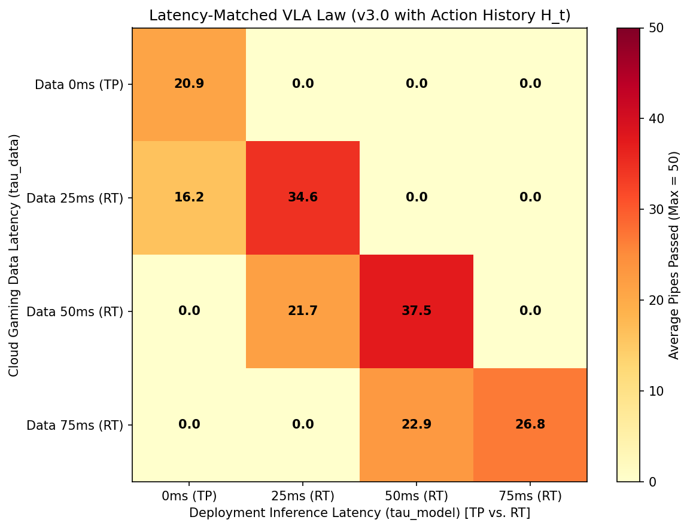

# Latency-Matched Law in Action Cloning: A Toy Experiment Inspired by *Gamer*

> **关于《Gamer》(arXiv:2611.18397) 论文中 RT（实时）模式性能反超 TP（时间暂停）模式现象的机制猜想与消融实验验证。**

## 💡 背景与核心猜想 (Motivation & Hypothesis)

在精读 Honkai AI 团队的《Gamer》(arXiv:2611.18397) 时，我注意到 **Table 5** 中一个非常有趣的反常现象：模型 `Gamer-35B-A3B-CPT` 在有推理延迟的 **RT（实时）模式** 下，得分显著反超了等效零延迟的 **TP（时间暂停）模式**（MCU 中 `RT - TP = +18.6`，平均 `+3.4`）。

针对这一现象，结合云游戏实际游玩经验，我提出如下**“延迟隐式对齐”猜想**：
1. **数据侧（人类提前量）：** 云游戏玩家在对抗网络延迟（RTT）时，会潜意识形成数十毫秒的**“操作提前量（Action Lead-Time）”**。模型通过 CPT/SFT 行为克隆，隐式学习到了带有提前量的控制策略。
2. **评测侧（推理延迟耦合）：** 
   - 在 **TP 模式（0ms 延迟）** 下，环境完全静止，模型自带的“提前量”反而会导致动作执行过早（如提前停下），从而引发任务失败；
   - 在 **RT 模式（~65ms 推理延迟）** 下，模型推理期间环境仍在惯性演化，**模型的推理延迟恰好填补了人类数据自带的操作提前量**，使得最终动作执行与目标状态高度重合，从而实现性能反超。

---

## 📊 实验设计与结果 (Toy Experiment & Results)

为了在轻量级环境中初步验证上述直觉，我构建了一个包含状态惯性的 Flappy Bird 2D 仿真环境：
* **训练数据生成 ($\tau_{\text{data}}$)：** 模拟不同网络与反应延迟 $\tau_{\text{data}} \in \{0, 25, 50, 75\}\text{ ms}$ 下带有对应“提前量”的专家轨迹并进行行为克隆训练。
* **部署推理评测 ($\tau_{\text{eval}}$)：** 在注入不同模型推理延迟 $\tau_{\text{eval}} \in \{0\text{ (TP)}, 25, 50, 75\}\text{ ms}$ 的环境下测试模型平均通过管道数（上限 50）。

### 实验结果：对角线匹配定律 (Latency-Matched Law)



实验结果呈现出极其显著的**主对角线最优分布（$\tau_{\text{eval}} \approx \tau_{\text{data}}$）**：
* **零延迟数据 ($\tau_{\text{data}}=0\text{ms}$)：** 仅在 `0ms (TP)` 下表现正常（20.9分），进入有延迟的 RT 环境后迅速失效。
* **带提前量数据 ($\tau_{\text{data}} \in \{25, 50, 75\}\text{ms}$)：** 在 `0ms (TP)` 模式下均因“操作过早”而严重退化（分别为 16.2 / 0.0 / 0.0）；但在**评测推理延迟与训练数据延迟相匹配的主对角线上，均取得了各自的最佳成绩（34.6 / 37.5 / 26.8）**，成功在极简环境中复现了《Gamer》Table 5 中 **“RT 显著反超 TP”** 的现象。

---

## 📁 仓库结构 (Structure)
```text
├── main.py              # 实验主脚本（包含环境定义、专家轨迹生成、模型训练与交叉评测）
├── heatmap.png          # 实验生成的 4x4 延迟匹配热力图
└── README.md            # 项目说明文档
```

---

## ✉️ 致谢与交流 (Acknowledgement)
本研究启发自 Honkai AI 团队的杰出工作《Gamer》(arXiv:2611.18397)。受限于个人算力，目前仅在 2D 玩具环境中进行了初步验证，若实验设计存在考虑不周的盲区，非常期待能得到各位老师与前辈的指点！
